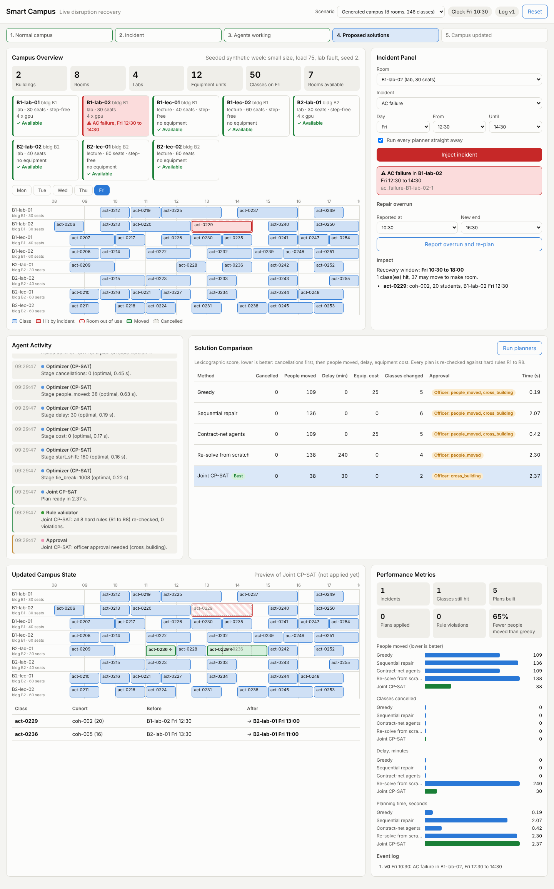

# Smart Campus: disruption recovery

A simulated campus that recovers from disruptions such as a lab lost to an AC failure. When a
room or a piece of equipment becomes unavailable, it re-plans **rooms, equipment and timing
together in one CP-SAT model**, while changing as little of the timetable as possible. Every
plan is re-checked against the same hard-rule library before it is applied to the simulated
campus.

It is a research prototype for a timetabling officer who approves re-plans. The question it is
built to answer: does joint minimal-change recovery beat repairing one domain at a time, and can
negotiating agents (contract-net) match a central solver?



## What it is, and what it is not

**It is**

- A digital twin of a campus (buildings, rooms, equipment pools, cohorts, faculty, a weekly
  timetable) whose state changes only through an append-only event log.
- A joint recovery model in OR-Tools CP-SAT with a lexicographic objective: fewest cancellations,
  then fewest people moved, then least delay, then lowest equipment cost, then smallest start
  shift, then a deterministic tie-break.
- Five comparable recovery methods: greedy, sequential per-domain repair, re-solve from scratch,
  joint CP-SAT, and contract-net agents.
- A seeded scenario generator, a frozen evaluation set, and an evaluation harness with paired
  statistics.
- A live web dashboard that walks through one incident end to end.

**It is not**

- A real building, HVAC or safety control system. Everything is simulated.
- An attendance system, chatbot, transport planner or full timetable generator.
- Built on real student or staff data. People are modelled only as cohorts and faculty.
- A production deployment, or a source of real-world savings claims.

The system runs fully offline. An LLM is optional and never checks rules, picks plans or writes
state (`LLM_ENABLED=false` by default).

## How it works

```
fault / hold / repair overrun
        │  appended as an event
        ▼
   sim/ (event log, state) ──► impact/ (recovery window, affected and movable classes)
                                   │
                                   ▼
        planners: joint CP-SAT │ greedy │ sequential │ re-solve │ contract-net
                                   │
                                   ▼
        rules/validator (R1 to R8, the same rules the solver encodes)
                                   │
                                   ▼
        coordinator/ (approval triggers, stale-plan check) ──► PlanApplied event
```

1. A fault (for example AI-Lab-01 closed Tue 10:00 to 14:00) is appended to the event log.
2. `impact/` derives the recovery window, the classes hit, and the classes that may move.
3. A planner proposes a plan. Joint builds one CP-SAT model from `rules/` and solves it stage by
   stage (C, P, D, K, S, T).
4. `rules/validator` re-checks the whole plan against the eight hard rules: assignment, room
   conflict, capacity, room type and equipment, move lead time, people conflict, accessibility,
   safety hold. A violation is a bug and stops the run.
5. The coordinator checks the plan is built on the current state version, applies the approval
   triggers (cancellations, more than 100 people moved, cross-building moves, late changes,
   safety holds), and appends `PlanApplied`.
6. A later event such as a repair overrun restarts the loop from the applied state.

Hard rules are written once, in `src/smartcampus/rules/`; the solver and the validator both
import them, and tests assert that the validator's verdict equals CP-SAT feasibility.

The full model (time grid, variables, rules, objective, solver settings, baselines, evaluation)
is in [docs/model-spec.md](docs/model-spec.md).

## Repository layout

```
src/smartcampus/
  domain/       Pydantic entities and the time model (30-minute slots, Mon to Fri 08:00 to 18:00)
  rules/        hard rules R1 to R8 (check + CP-SAT encoding) and the plan validator
  solver/       CP-SAT model, lexicographic stages, objective, conflict explanation
  sim/          SQLite append-only event store and state projection
  impact/       recovery window, affected and movable classes
  generator/    scenario files and the seeded synthetic generator
  baselines/    greedy, sequential per-domain repair, re-solve from scratch
  agents/       room and equipment agents, contract-net manager
  coordinator/  run, approval triggers, re-planning, recovery loop
  eval/         metrics, harness, statistics, report, run manifest
  reporting/    text and JSON run summaries
  api/          FastAPI app and static page for the demo dashboard
  cli.py        the `smartcampus` command
scenarios/
  dev/          hand-written demo scenarios (AC failure, cascade, repair overrun)
  smoke/        20 generated smoke instances (not part of the evaluation set)
  frozen/       the frozen v1.0 evaluation set, 405 instances (do not edit)
tests/          unit, property (Hypothesis) and golden tests
docs/           model spec, demo guide, ADRs, measured results
```

## Getting started

### Prerequisites

- **git**
- **[uv](https://docs.astral.sh/uv/)**, the Python package manager. Install it with
  `curl -LsSf https://astral.sh/uv/install.sh | sh` on macOS or Linux, or
  `powershell -ExecutionPolicy ByPass -c "irm https://astral.sh/uv/install.ps1 | iex"` on Windows.
- Python 3.12. You do not need to install it yourself: `uv sync` downloads it if it is missing.

### 1. Clone and install

```bash
git clone https://github.com/sohanroy676/campus-ai.git
cd campus-ai
uv sync --extra api
```

`uv sync` creates `.venv/` with the pinned dependencies from `uv.lock`, including the dev tools.
`--extra api` adds FastAPI and Uvicorn for the web dashboard. Optionally copy `.env.example` to
`.env`; the defaults (`LLM_ENABLED=false`) are all you need.

Check the install:

```bash
uv run smartcampus --help
```

### 2. Run the CLI

Run the demo scenario (an AC failure in an AI lab) with the joint solver:

```bash
uv run smartcampus run scenarios/dev/ac-failure.json --method joint
```

Expected output, in short: `ml-lab` moves from AI-Lab-01 Tue 10:00 to AI-Lab-02 Tue 09:00, three
GPUs are carried over, and the score is 0 cancellations and 26 people moved, with all hard rules
satisfied. `--method greedy` on the same scenario moves 55 people.

Other commands:

```bash
# Every method on one scenario, side by side (stage values C P D K S T and seconds)
uv run smartcampus compare scenarios/dev/ac-failure.json

# Write a JSON report and keep the event log somewhere else
uv run smartcampus run scenarios/dev/ac-failure.json --method greedy --report var/greedy.json --db var/greedy.db

# A cascade: plan the AC failure, then re-plan after a repair overrun
uv run smartcampus cascade scenarios/dev/ac-cascade.json --followups scenarios/dev/ac-cascade-overrun.json

# Generate a seeded scenario (size small|medium|large, load 10-95, severity room|building|hold)
uv run smartcampus generate --size small --load 75 --severity room --seed 2 --out var/scenarios
uv run smartcampus run var/scenarios/small-l75-room-s2.json --method joint

# Evaluate methods on a scenario set (resumable; writes results.jsonl, report.md, manifest.json)
uv run smartcampus eval scenarios/smoke/ --methods greedy,joint --pattern "small-*" --out var/eval-smoke
```

Methods are `joint`, `greedy`, `resolve`, `sequential` and `contract_net` (or `all` for
`compare` and `eval`). Run any command with `--help` for its options and exit codes. The event
log defaults to `var/campus.db`; `run` and `cascade` replace an earlier event log at that path.
`var/` is gitignored.

The full evaluation on `scenarios/frozen/` (405 instances, all methods) takes many hours; see
[ADR 0007](docs/adr/0007-implement-first-run-the-full-evaluation-last.md) before starting it.

### 3. Run the web dashboard

```bash
uv run smartcampus demo
```

Then open **http://127.0.0.1:8000/** in a browser. Stop the server with Ctrl+C.

Options: `--scenario ac-failure|ac-cascade|generated-small` (also selectable in the page header),
`--port 8080`, `--host 0.0.0.0`. The dashboard runs offline with no frontend build step.

To walk through it: click **Inject incident** (the form is pre-filled with the scenario's AC
failure), watch the agents and the five planners in Agent Activity, compare their plans in
Solution Comparison, click a row to preview it, then **Apply** it. The panels and a five-minute
demo script are in [docs/demo.md](docs/demo.md).

### 4. Run the tests and checks

```bash
uv run pytest -m "not slow"          # the suite without the minutes-long large-instance tests
uv run pytest                        # everything (takes a while)
uv run pytest tests/unit -q          # fast unit tests only
uv run ruff check . && uv run ruff format --check .
uv run mypy src
```

CI runs the same checks plus a secret scan on every push and pull request to `main`.

## Results so far

Measured on this code, not claims about real campuses:

- Demo scenario (`ac-failure`): joint and sequential move 26 people, greedy and contract-net 55;
  no method cancels a class.
- Generated small campus (small, load 75, room fault, seed 2): joint moves 38 people, greedy 109.
- Pre-evaluation checks on parts of the frozen set (timing, plan rates, a one-seed-per-cell
  check on large instances) are in [docs/results/](docs/results/).

The full evaluation on the 405 frozen instances has **not been run yet**, so there is no
answer yet to whether joint beats sequential repair overall. When it runs, results are reported
as medians and IQR, win/tie/loss counts and Holm-adjusted paired Wilcoxon tests, with threats to
validity (spec section 10).

## Reproducibility

Every evaluation run uses `num_workers=1` and `random_seed=42`. Each record stores the git commit,
generator version and solver settings, and `manifest.json` stores the machine and library
versions; resuming under another commit or environment is refused. Scenarios in
`scenarios/frozen/` are regenerated byte for byte by the golden tests.

## Documentation

- [docs/model-spec.md](docs/model-spec.md): the model, rules, objective, baselines and evaluation
- [docs/demo.md](docs/demo.md): the live dashboard and a demo script
- [docs/adr/](docs/adr/): architecture decision records
  - [0002 Lexicographic objective and rule encoding](docs/adr/0002-lexicographic-objective-and-rule-encoding.md)
  - [0003 Event log versions and stale plans](docs/adr/0003-event-log-versions-and-stale-plans.md)
  - [0006 Large time tier and complete hint](docs/adr/0006-large-time-tier-and-complete-hint.md)
  - [0007 Implement first, run the full evaluation last](docs/adr/0007-implement-first-run-the-full-evaluation-last.md)
  - [0008 Approval record and re-planning base](docs/adr/0008-approval-record-and-replanning-base.md)
  - [0009 Contract-net limit after the first auction](docs/adr/0009-contract-net-limit-after-first-auction.md)
  - [0011 Demo dashboard without a frontend build](docs/adr/0011-demo-dashboard-without-a-frontend-build.md)
- [ROADMAP.md](ROADMAP.md): what is done and what is next
- [CHANGELOG.md](CHANGELOG.md)
- [AGENTS.md](AGENTS.md) and [CLAUDE.md](CLAUDE.md): rules for contributors and coding agents

## Stack

Python 3.12, uv, OR-Tools CP-SAT, Pydantic 2, Typer, SQLite, NumPy, SciPy, FastAPI and Uvicorn
(demo), pytest and Hypothesis, ruff, mypy.
